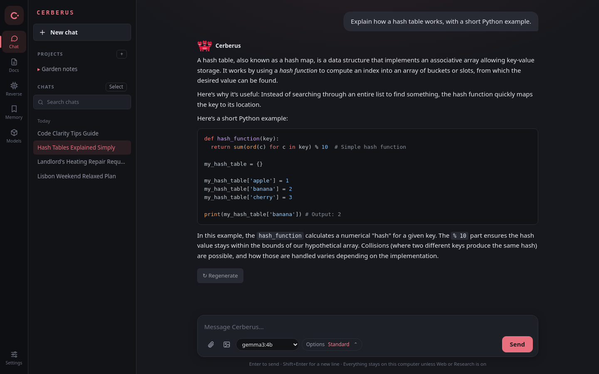
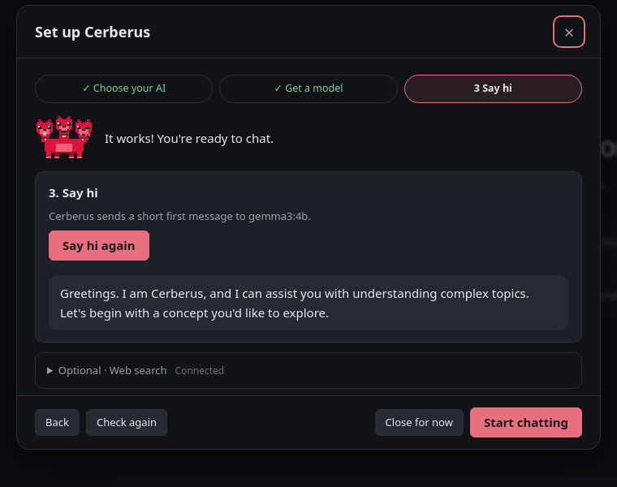
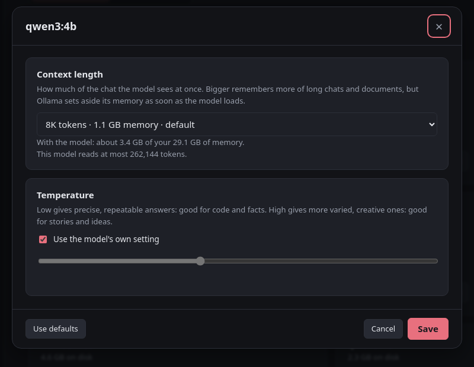
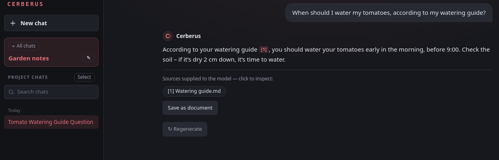

<p align="center">
  
</p>

<h1 align="center">Cerberus</h1>

<p align="center">
  <b>A desktop workspace for chat, documents, and research.</b><br>
  Local AI for private work. A cloud model when you need one.
</p>

<p align="center">
  <a href="#download"></a>
  <a href="https://github.com/23lambi/Cerberus-ai/actions/workflows/checks.yml"></a>
  <a href="LICENSE"></a>
</p>

<p align="center">
  <a href="#download">Download</a> ·
  <a href="#see-it-in-action">Tour</a> ·
  <a href="#what-it-does">Features</a> ·
  <a href="#ai-engines">AI engines</a> ·
  <a href="docs/guide.md">Guide</a> ·
  <a href="docs/roadmap.md">Roadmap</a>
</p>

<p align="center">
  
  <br><sub>Shown with sample data and a local gemma3:4b model.</sub>
</p>

## Download

<p align="center">
  <a href="#windows-powershell"></a>
  <a href="#linux-and-macos"></a>
  <a href="#linux-and-macos"></a>
  <a href="#linux-and-macos"></a>
</p>

1. **Install prerequisites:** [Python 3.14](https://www.python.org/downloads/)
   and [Git](https://git-scm.com/downloads).
2. **Open a terminal** and copy the commands for your computer below.
3. **Start chatting.** A short setup gets your AI ready on the first launch.

### Windows (PowerShell)

```powershell
git clone https://github.com/23lambi/Cerberus-ai.git
cd Cerberus-ai
py -3.14 -m venv venv
.\venv\Scripts\python.exe -m pip install -r requirements.txt
.\venv\Scripts\python.exe desktop.py
```

### Linux and macOS

```bash
git clone https://github.com/23lambi/Cerberus-ai.git
cd Cerberus-ai
python3.14 -m venv venv
venv/bin/python -m pip install -r requirements.txt
venv/bin/python desktop.py
```

<details>
<summary><b>Add Cerberus to your app menu</b></summary>

After installing, run once from the `Cerberus-ai` folder:

**Windows (PowerShell)**

```powershell
powershell -ExecutionPolicy Bypass -File install-desktop.ps1
```

**Linux and macOS**

```bash
sh install-desktop.sh
```

Then open **Cerberus** from the Start menu on Windows, your app menu on Linux,
or `~/Applications/Cerberus.app` on macOS. Keep the project folder in place;
the shortcut uses it to start the app.

</details>

<details>
<summary><b>Start again or update</b></summary>

To start again, open a terminal in `Cerberus-ai` and run the last command for
your platform above, or use your app-menu shortcut.

To update, close Cerberus, run `git pull` in that folder, then repeat the
`pip install -r requirements.txt` command for your platform. Your chats and
settings stay in your data folder.

</details>

## See it in action

<table>
  <tr>
    <td width="50%" valign="top">
      <h3>Ready in three steps</h3>
      Choose where your AI runs, get a model that fits your computer, and say hi.
      The mascot tells you when something's missing, and when it works.
      <br><br>
      
    </td>
    <td width="50%" valign="top">
      <h3>Tune every model</h3>
      Choose how much of the chat a model sees at once, with the memory each size
      takes and a suggestion for your computer, and how creative it answers.
      <br><br>
      
    </td>
  </tr>
  <tr>
    <td valign="top">
      <h3>Projects that know your files</h3>
      Keep chats and documents together. Answers cite the documents they used,
      and you can open each source.
      <br><br>
      
    </td>
    <td valign="top">
      <h3>A companion while it works</h3>
      The pixel mascot's three heads bob while Cerberus thinks, and nod while it
      writes the answer.
      <br><br>
      
      
    </td>
  </tr>
</table>

## What it does

<table>
  <tr>
    <td width="50%" valign="top">
      <h3>Chat</h3>
      Streaming answers, image input, and tools like a calculator and memory
      search. <b>Deep think</b> drafts, reviews, then answers: three heads, one answer.
    </td>
    <td width="50%" valign="top">
      <h3>Documents</h3>
      Organize projects, search files, edit Markdown, and review AI changes
      before applying them.
    </td>
  </tr>
  <tr>
    <td valign="top">
      <h3>Research</h3>
      Search the web and get reports with citations, saved as documents.
    </td>
    <td valign="top">
      <h3>Memory</h3>
      Save useful facts once, and Cerberus remembers them in every conversation.
    </td>
  </tr>
  <tr>
    <td valign="top">
      <h3>Works with any model</h3>
      Pick any model you like. Reasoning written between think tags goes to
      "Show thinking", and tool calls in every common format really run,
      instead of showing up as raw text.
    </td>
    <td valign="top">
      <h3>Your data stays yours</h3>
      Chats and documents live on your computer. Back up everything, or export
      a chat as Markdown or JSON, at any time.
    </td>
  </tr>
</table>

## AI engines

| Run locally | Connect to cloud |
| --- | --- |
| Ollama · llama.cpp · LM Studio · Jan | Hugging Face · OpenAI · Groq · OpenRouter |

Other OpenAI-compatible servers work too. Image and tool support depends on the
engine and model. Cerberus can start its managed llama.cpp server or install its
own Ollama. Optional web search and Research use SearXNG.

In the app, open **Models** to download models, connect to a running local app,
or open a model's **Settings**. Choose **Use in chat** to select a model.
[Engine setup guide →](docs/guide.md#choosing-an-ai-engine)

## Privacy

> [!NOTE]
> Local chats and documents stay on your computer. When you use a cloud engine,
> your messages and the context you provide go to that service. Web search also
> contacts the configured search service and the pages it opens. API keys are
> stored separately from the chat database and are excluded from backups.

## What's next

Coming up, in order: API keys that stay with their own connection, editing a
sent message with both versions kept, a developer mode with custom assistants,
and MCP tools. See the [roadmap](docs/roadmap.md).

## Build from source

The desktop app uses FastAPI, SQLite, JavaScript, and pywebview. Follow the
[terminal installation](#download) above to set up a source checkout.

<details>
<summary><b>Development checks · Python 3.14</b></summary>

Run checks:

```bash
venv/bin/python -m pytest -q
node tests/frontend.test.cjs
```

With Ollama running, check real models too:

```bash
venv/bin/python scripts/check_models.py    # clean answers from every installed model
venv/bin/python scripts/check_prompts.py   # does the model make things up about itself?
```

The pixel mascot is drawn by `scripts/make_mascot.py`; edit its pixel rows and
run it again to change the mascot and its animations.

</details>

[User guide](docs/guide.md) · [Contributing](CONTRIBUTING.md) · [Project layout](docs/development/architecture.md) · [Release process](docs/releasing.md) · [Roadmap](docs/roadmap.md)

## Feedback and license

Found a bug or have an idea? [Open an issue](https://github.com/23lambi/Cerberus-ai/issues/new/choose).
Settings → Help → **Copy diagnostics** collects the details a bug report needs.

Cerberus project code is licensed under [Apache 2.0](LICENSE); bundled libraries
retain their [own licenses](static/vendor/README.md).
