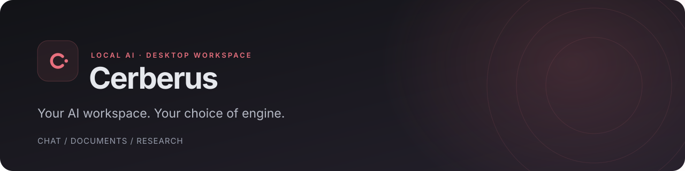

<div align="center">
  
  <p>Chat, work with documents, and research—all in one desktop app.</p>
  <p><a href="#get-started">Get started</a> · <a href="#ai-engines">AI engines</a> · <a href="docs/guide.md">User guide</a></p>
</div>

<p align="center">
  <a href="https://github.com/23lambi/Cerberus-ai/actions/workflows/checks.yml"></a>
  <a href="LICENSE"></a>
  
</p>

---

## Built for everyday work

- **Chat your way** — regular conversations, Deep think, images, and tools.
- **Keep work together** — projects, file attachments, and searchable documents.
- **Write and revise** — Markdown editing, version history, and AI edits you review.
- **Remember what matters** — saved facts available across your chats.
- **Research with sources** — web search and reports with numbered citations.
- **Own your data** — local storage, full backups, and Markdown or JSON exports.

## Get started

Requires **Python 3.14**. Clone the project first:

```bash
git clone https://github.com/23lambi/Cerberus-ai.git
cd Cerberus-ai
```

**Linux & macOS**

```bash
python3 -m venv venv
venv/bin/pip install -r requirements.txt
sh install-desktop.sh
```

<details>
<summary>Windows · PowerShell</summary>

```powershell
py -3.14 -m venv venv
venv\Scripts\pip install -r requirements.txt
powershell -ExecutionPolicy Bypass -File install-desktop.ps1
```

</details>

Launch **Cerberus** from your app menu. Open **Settings → Setup check**, choose
an engine and a model, then start chatting. The app handles its local server;
no browser tab is needed.

Linux is tested by the author. macOS and Windows support is prepared but untested.

## AI engines

| On your computer | Cloud services |
| --- | --- |
| Ollama · llama.cpp · LM Studio · Jan | Hugging Face · OpenAI · Groq · OpenRouter |

Other OpenAI-compatible servers are supported too. Model support for images
and tools varies by engine and model.

**Models → Your models** manages your Ollama collection. **Find models** lets
you browse downloads or discover running **Local apps**, then choose **Use in chat**.

Cerberus can install its own Ollama or start an installed llama.cpp server with
a GGUF file. Web search and Research use an optional SearXNG server.
[Setup details →](docs/guide.md#choosing-an-ai-engine)

## Privacy

Chats and documents are stored locally. Cloud engines receive your messages
and supplied context; web features contact search services and websites.
API keys are stored separately from the database and excluded from backups.

## Development

Built with **FastAPI**, **SQLite**, **plain JavaScript**, and **pywebview**.

```bash
venv/bin/python -m pytest -q
node tests/frontend.test.cjs
```

[User guide](docs/guide.md) · [Contributing](CONTRIBUTING.md) · [Project layout](docs/development/architecture.md) · [Roadmap](docs/roadmap.md)

## Feedback & license

Found a bug or have an idea? [Open an issue](https://github.com/23lambi/Cerberus-ai/issues/new/choose).

[MIT licensed](LICENSE). Bundled libraries retain their [own licenses](static/vendor/README.md).
